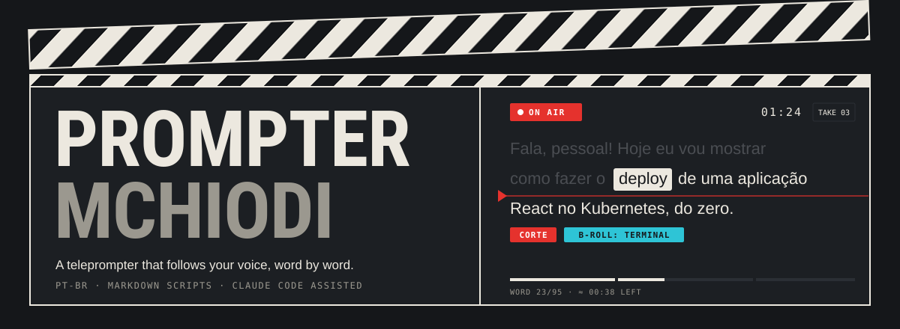
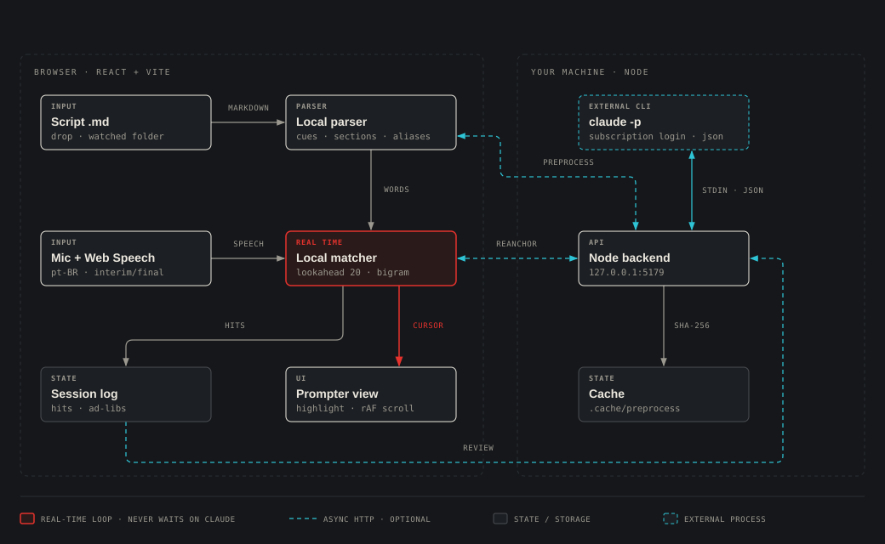
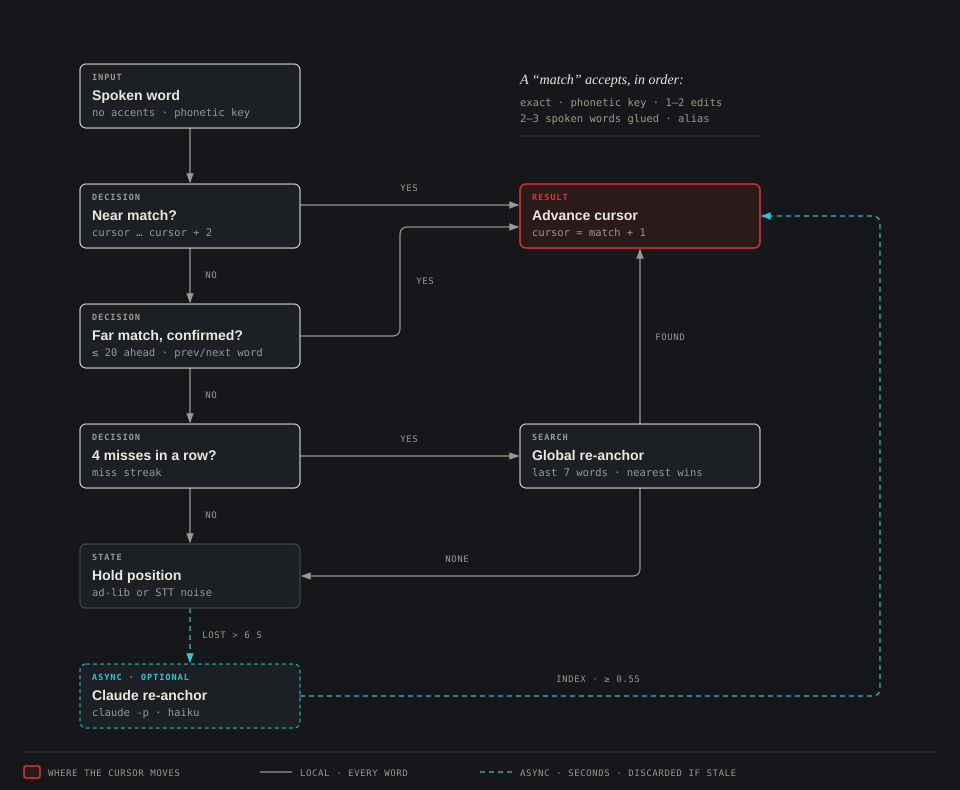
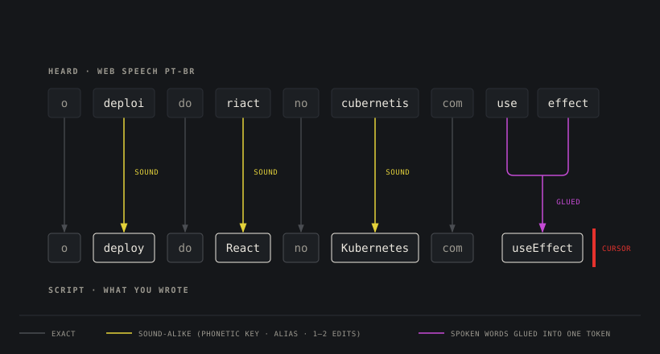
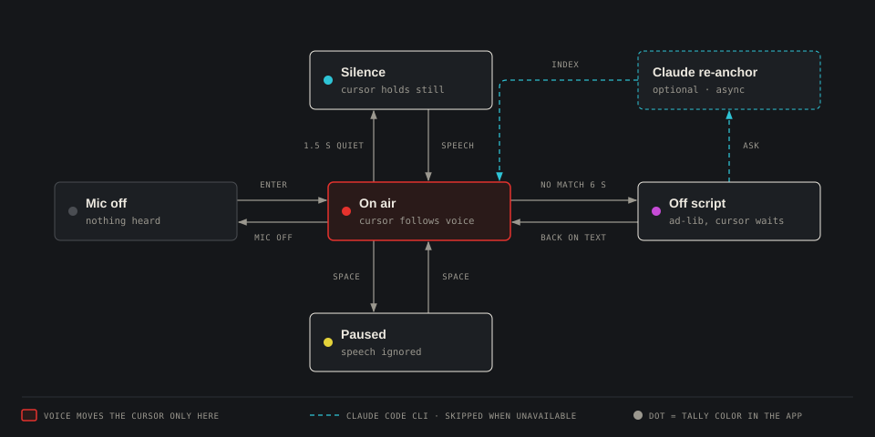

<p align="center">
  
</p>

<p align="center">
  
  
  
  
  
  
  <a href="https://github.com/MatheusChiodi/prompter-mchiodi/actions/workflows/ci.yml"></a>
  <a href="LICENSE"></a>
</p>

<p align="center">
  <b>You read. It scrolls.</b><br>
  A voice-driven teleprompter built for creators who record tech videos in Brazilian Portuguese,<br>
  where half the vocabulary is English: <i>deploy, React, Kubernetes, useEffect</i>.
</p>

---

## Why another teleprompter

Voice teleprompters already exist. They tend to break the moment you say **"deploy"** in Portuguese, because the speech recognizer writes *"deploi"*, *"riact"* or *"cubernetis"* and the matcher gives up.

Prompter MChiodi was designed around that failure:

- **It follows you word by word.** The word you are about to read is highlighted and sits on an adjustable reading line.
- **It understands tech terms spoken in pt-BR.** It compares how words sound (a phonetic key), uses per-term aliases, glues split words back together (*"use effect"* → `useEffect`) and tolerates small typos.
- **It waits when you stop.** Silence holds the cursor. Ad-libs don't drag it around. It re-anchors when you get back on script, even if you jumped back a paragraph.
- **It reads Markdown.** Headings become sections with time estimates. `[CORTE]`, `[B-ROLL: …]`, `[PAUSA]` and `<!-- notes -->` show up as colored cues and are never expected in speech.
- **Claude Code makes it smarter, without an API key.** It calls the `claude` CLI you already have logged in with your subscription, only for the slow, smart work. The app runs fully without it.

---

## How it works

<p align="center">
  
</p>

The design rule: **the real-time loop never waits on anything slow.**

| Path | What happens | Latency |
|---|---|---|
| **Real time** (red) | Web Speech → local matcher → cursor → highlight and scroll | every recognition event |
| **Prepare** | `.md` → Claude builds aliases for tech terms, section timings and extra cues. The result is cached by SHA-256 | ~15 s once, then instant |
| **Re-anchor** | You're lost for more than 6 s → Claude gets the last words heard plus a window of the script, and returns a position | ~5 s, async |
| **Review** | After the take, Claude lists what you skipped, repeated or improvised | on demand |

If Claude's re-anchor answer arrives after you've already found your way back, it's **discarded**: the local matcher always wins.

---

## The matcher, one word at a time

<p align="center">
  
</p>

The core lives in [`web/src/lib/tracker.ts`](web/src/lib/tracker.ts). It is a **pure function** (`advance(state, script, spokenWords)`) and has its own test suite.

- **Near match.** The spoken word matches the current word or one of the next two. Small, safe steps.
- **Far match.** Up to 20 words ahead, but only if the *previous* or *next* spoken word confirms it. This keeps "de", "que" and "o" from dragging the cursor across the paragraph.
- **Global re-anchor.** After 4 misses in a row, the last 7 spoken words are aligned against the whole script:
  - stopwords count half;
  - long jumps need more evidence;
  - ties go to the spot **closest to the cursor**, not to the first occurrence.
- **Confirmed vs provisional.** Final results move a *committed* state. Interim results are replayed on top of it at every event, so a recognizer that rewrites its guess can never corrupt the position.

### What "a match" means

<p align="center">
  
</p>

Every word is normalized: accents stripped, lowercased, alphanumeric only. It is then compared in this order:

1. **Exact.** `ação` = `acao`.
2. **Phonetic key.** A sound fingerprint for Portuguese and anglicisms: `c/k/q`, `e≈i`, `o≈u`, `y→i`, `w→u`, silent `h`, collapsed doubles, a dropped final vowel. `kubernetes` and `cubernetis` both become `kubirnitis`.
3. **Edit distance.** 1 typo (2 for long words), only for words of 5+ letters. Short words must match exactly.
4. **Glued words.** 2–3 spoken words joined: `use` + `effect` → `useEffect`, `node` + `js` → `Node.js`.
5. **Aliases.** A built-in offline dictionary ([`tech-aliases.ts`](web/src/lib/tech-aliases.ts)) plus whatever Claude generated for this specific script.

---

## Prompter modes

<p align="center">
  
</p>

The tally light at the top of the screen always tells you which one you're in.

---

## Quick start

**Windows:** double-click **`iniciar.bat`**. It installs dependencies on the first run, starts everything and opens Chrome (or Edge).

**Any OS:**

```bash
npm install
npm run dev          # backend on :5179, app on http://localhost:5173
```

One-process mode:

```bash
npm run build && npm start     # http://127.0.0.1:5179
```

| Requirement | Why |
|---|---|
| Node 20+ | backend and tooling |
| Chrome or Edge | Web Speech API. Firefox doesn't have it, and Chrome/Edge need internet for speech |
| [Claude Code](https://docs.claude.com/claude-code) *(optional)* | run `claude` once and `/login` with your subscription |

---

## Writing a script

```markdown
# Deploying React on Kubernetes          ← section (not spoken; toggle in settings)

Hey everyone! Today we **ship** a `useEffect`-heavy app.   ← spoken, styled
[CORTE]                                   ← red cue
[B-ROLL: terminal running docker build]   ← cyan cue
[PAUSA]                                   ← magenta cue
<!-- remember to smile -->                ← yellow note
> Look at camera 2                        ← note for you, not spoken
- List items are spoken too
```

Drop the file on the start screen, or save it in **`roteiros/`**. That folder is watched: saving in your editor reloads the open script **at the same position**.

---

## Keyboard

| Key | Action |
|---|---|
| <kbd>Enter</kbd> | microphone on / off |
| <kbd>Space</kbd> | pause / resume following |
| <kbd>↑</kbd> <kbd>↓</kbd> | previous / next sentence |
| <kbd>Shift</kbd>+<kbd>↑</kbd> <kbd>↓</kbd> · <kbd>PgUp</kbd> <kbd>PgDn</kbd> | previous / next section |
| <kbd>Home</kbd> | back to the top |
| <kbd>M</kbd> · <kbd>V</kbd> | mirror horizontal · vertical (beam-splitter glass) |
| <kbd>+</kbd> <kbd>−</kbd> | text size |
| <kbd>[</kbd> <kbd>]</kbd> | move the reading line |
| <kbd>R</kbd> | ask Claude to find your place now |
| <kbd>?</kbd> | show / hide shortcuts |
| <kbd>Esc</kbd> | close shortcuts / exit |

Click any word to jump to it. The interface switches between **Português** and **English** from the PT/EN toggle on the start screen.

---

## Claude Code, without an API key

The backend runs the CLI as a child process, with the prompt sent over **stdin**:

```bash
claude -p --output-format json --tools "" --strict-mcp-config \
       --setting-sources local --no-session-persistence [--model haiku]
```

- `ANTHROPIC_API_KEY` / `ANTHROPIC_AUTH_TOKEN` are **removed** from the child's environment, so only your subscription login can be used.
- It runs from a neutral temp folder with no tools and no MCP servers, so it starts fast and can't touch your files.
- Every failure has a fallback, and the app keeps working:

| Failure | Detected by | What the app does |
|---|---|---|
| CLI not installed | ENOENT / exit 9009 | local parser + built-in aliases; re-checks every 60 s |
| Not logged in | CLI message | tells you to run `claude` → `/login` |
| Usage limit | CLI message / 429 | 15-minute cooldown |
| Timeout | per-call timer | kills the process tree |
| Garbled answer | JSON parse | ignored, local result kept |

---

## Project layout

```
prompter-mchiodi/
├─ iniciar.bat              one-click start (Windows)
├─ roteiros/                watched script folder
├─ server/src/              Node, zero dependencies
│  ├─ index.js              HTTP + SSE + static files
│  ├─ claude.js             CLI runner, error classes, cooldown
│  ├─ prompts.js            prepare / re-anchor / review prompts
│  └─ watcher.js            fs.watch with debounce
└─ web/src/
   ├─ lib/tracker.ts        the matcher (pure, tested)
   ├─ lib/normalize.ts      normalization, phonetic key, edit distance
   ├─ lib/markdown.ts       script parser: words, cues, sections
   ├─ lib/speech.ts         Web Speech engine (swappable interface)
   ├─ lib/i18n.tsx          PT / EN strings
   └─ components/           Home (clapperboard), Prompter, Review
```

```bash
npm test     # matcher + parser suite
```

---

## Design notes

The interface borrows from the studio: the start screen is a **clapperboard** with production, script, take and date fields, and it snaps shut when you open a script. Cues use **SMPTE color bars**. The reading face is **Atkinson Hyperlegible**, a typeface designed for maximum legibility, which is the whole job of a teleprompter.

Deeper write-ups (in Portuguese):

- [Analysis of existing voice teleprompters](docs/01-analise.md): what was kept, what was dropped, and why
- [Architecture](docs/02-arquitetura.md) · [interactive flow diagram](docs/fluxo.html)
- [Decisions and trade-offs](docs/03-decisoes.md): Web Speech vs local Whisper, and more

## Contributing

Issues and pull requests are welcome, in English or Portuguese. Read [CONTRIBUTING.md](CONTRIBUTING.md) and the [Code of Conduct](CODE_OF_CONDUCT.md). Report security problems privately, as described in [SECURITY.md](SECURITY.md). Changes are tracked in [CHANGELOG.md](CHANGELOG.md).

## License

[MIT](LICENSE) © 2026 Matheus Chiodi

## Credits

The matching approach builds on ideas studied in [ShayneP/local-teleprompter](https://github.com/ShayneP/local-teleprompter) (sequential cursor with bigram confirmation) and [VoicePrompter](https://github.com/aaronse/VoicePrompter) (bracket cues, mirroring, reading-line position).

<p align="center"><sub>Made by <b>MChiodi</b> · rolling in 3, 2, 1…</sub></p>
